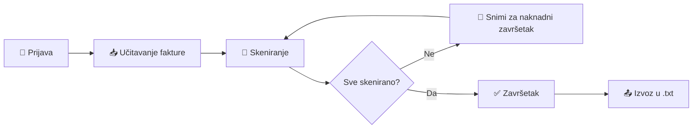

# 📦 Magacin Control

**Kontrola otpreme robe — skeniraj, uporedi, otpremi bez greške.**

---

## 📖 O aplikaciji

**Magacin Control** je WPF desktop aplikacija za magacionere firme **PanSport**. Služi da se pre otpreme proveri da li se roba koja se pakuje **tačno poklapa sa fakturom**.

Faktura se učita iz tekstualnih fajlova, magacioner skenira barkod svakog artikla koji ulazi u paket, a aplikacija odmah javlja ako je artikal pogrešan ili ako je spakovano više nego što piše na fakturi. Faktura se može završiti tek kada je **sve skenirano tačno**.

## ✨ Mogućnosti

| | Funkcija |
|---|---|
| 📥 | Učitavanje fakture i stavki iz `.txt` fajlova |
| 🔎 | Skeniranje barkodova uz trenutnu proveru i označavanje poslednjeg skeniranog artikla |
| 🔢 | Unos količine ručno za artikle koji se ne skeniraju pojedinačno |
| 💾 | Snimanje započete fakture za naknadni završetak |
| ✅ | Završetak fakture tek kada su sve stavke ispravno skenirane |
| 🗂️ | Pregled i filtriranje faktura (broj, datum, status) |
| 📤 | Izvoz završene fakture u `.txt` fajl |
| 👤 | Prijava korisnika i administratorski prozor za upravljanje nalozima |

---

## 🔄 Kako aplikacija radi

### Pregled toka

### 1. 🔐 Prijava
Pri pokretanju aplikacija proverava bazu i primenjuje migracije, pa prikazuje prozor za prijavu. Lozinke se čuvaju kao hash. Korisnik može biti **običan** (magacioner) ili **administrator**; dugme *Administrator* vide samo administratori.

### 2. 📥 Učitavanje fakture
Dugme **Učitaj** otvara izbor fajlova. Jedna faktura se sastoji od tri fajla istog osnovnog imena:

| Fajl | Sadržaj (razdvojeno tabulatorom) |
|---|---|
| `{broj}.txt` | Zaglavlje: broj fakture, datum, šifra kupca, naziv kupca |
| `{broj}_code.txt` | Artikli: šifra, barkod, naziv, oznaka, oznaka usluge |
| `{broj}_item.txt` | Količine: šifra artikla, količina sa fakture |

Dovoljno je izabrati samo osnovni fajl; aplikacija sama pronalazi `_code` i `_item` fajlove. Pri učitavanju:

- **Ista šifra više puta** → količine se sabiraju u jednu stavku.
- **Isti barkod dodeljen različitim artiklima** → učitavanje se prekida uz upozorenje koje navodi sporne barkodove.
- **Faktura već postoji u bazi** → ne učitava se ponovo.
- **Usluge** (oznaka usluge počinje sa `7`) → ne skeniraju se i imaju količinu 0.
- Posle uspešnog učitavanja izvorni fajlovi se **brišu**.

### 3. 💾 Snimanje za naknadni završetak
Dugme **Snimi za naknadni završetak** upisuje trenutno stanje u bazu, faktura ostaje u statusu **U radu**. Stanje se snima i automatski pri filtriranju, odjavi i zatvaranju aplikacije, pa napredak nije izgubljen.

### 4. ✅ Završetak
Dugme **Završetak** proverava sve stavke. Ako je nešto neskenirano ili se količine ne poklapaju, prikazuje se spisak nepodudaranja. Kad je sve tačno, status fakture prelazi iz **U radu** u **Završeno** i faktura se zaključava za dalje skeniranje.

### 5. 📤 Izvoz
Za završenu fakturu dugme **Izvezi u .Csv** snima zaglavlje fakture u `.txt` fajl (podrazumevana putanja `C:\OTPREME\`), a zatim se aplikacija zatvara.

### 6. 👤 Administracija
Administrator može da dodaje nove korisnike, menja podatke (korisničko ime, ime, prezime, administratorska prava) i postavlja nove lozinke.

---

PanSport · Magacin Control

